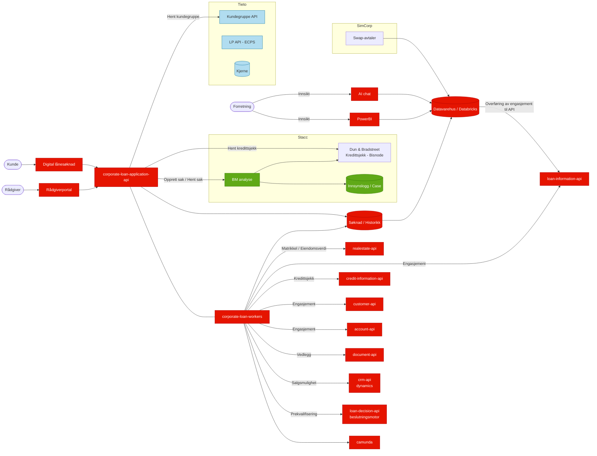

+++
schema_version = 3
id = "01a211a1-50f6-76db-a854-0d4164d0ad32"
kind = "note"
state = "open"
created_at = "2026-11-25T07:35:14Z"
updated_at = "2026-11-25T07:37:41Z"
title = "Arkitektur - lånesøknad (mermaid)"
tags = ["note"]
log_seq = 2
+++

# Arkitektur - lånesøknad (mermaid)

Generert av claude, fra Joakim sin skisse
